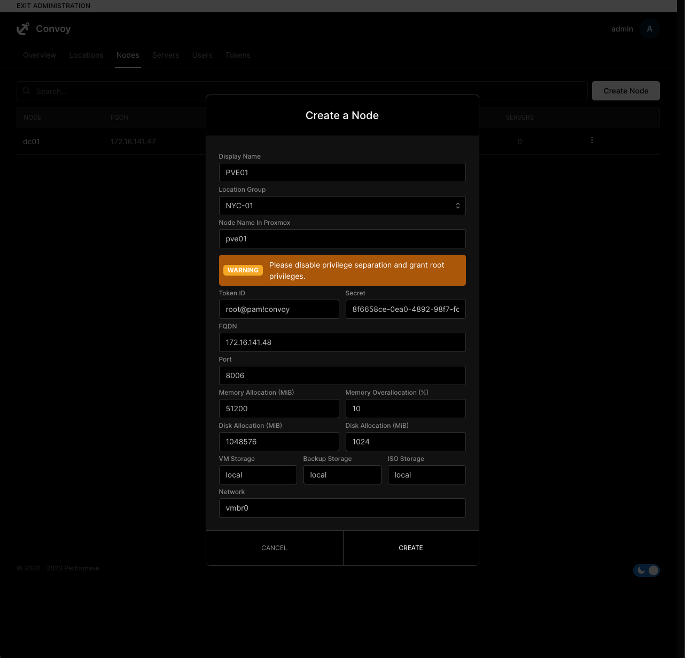

# Convoy documentation

Plain Markdown, rendered at [convoypanel.com/docs](https://convoypanel.com/docs). The ConvoyPanel
console pulls this repository every ten minutes and renders the pages itself, so there is no build
step and nothing to install here.

## Layout

| Path               | Holds                                                                                        |
|--------------------|----------------------------------------------------------------------------------------------|
| `docs/`            | The pages. `docs/panel/v4/getting-started.md` is served at `/docs/panel/v4/getting-started`. |
| `documentation.md` | The sidebar, as a nested Markdown list.                                                      |
| `assets/images/`   | Images, referenced from pages as `/assets/images/<file>`.                                    |

## Adding a page

1. Create the file under `docs/`. Its first line is a level-one heading; that heading is the page
   title, and the `##` and `###` headings below it make up the table of contents.
2. Add a line for it to `documentation.md`.

## Sidebar

`documentation.md` is a nested list indented with four spaces. An item without a link is a group; a
link is a page. Links are paths relative to `docs/` without the `.md` extension, or full URLs for
external sites. A `+` bullet starts a group collapsed.

```markdown
- Panel
    - v4
        - [Getting Started](panel/v4/getting-started)
        + Application API
            - [Getting Started](panel/v4/api/getting-started)
    + v3 (EOL)
        - [Getting Started](panel/v3/getting-started)
- Miscellaneous
    - [Resources](https://github.com/ConvoyPanel/panel/discussions/categories/resources)
```

## Alerts

Alerts use the GitHub syntax: a blockquote whose first line names the kind, with an optional title
after it. The kinds are `NOTE`, `TIP`, `IMPORTANT`, `WARNING` and `CAUTION`.

```markdown
> [!WARNING]
> The panel cannot be installed in a container due to limitations with Docker.

> [!TIP] Pro-tip
> Convoy comes with auto-TLS.
```

## Images and links

Put images in `assets/images/` and reference them by absolute path:

```markdown

```

Link to other pages by their URL path:

```markdown
[Coterm](/docs/misc/coterm)
```

## Contributing

Every rendered page links to its source file on GitHub, so small fixes can be made there directly.
For anything larger, read the [writing guide](.github/contributing/guidelines.md) first.
