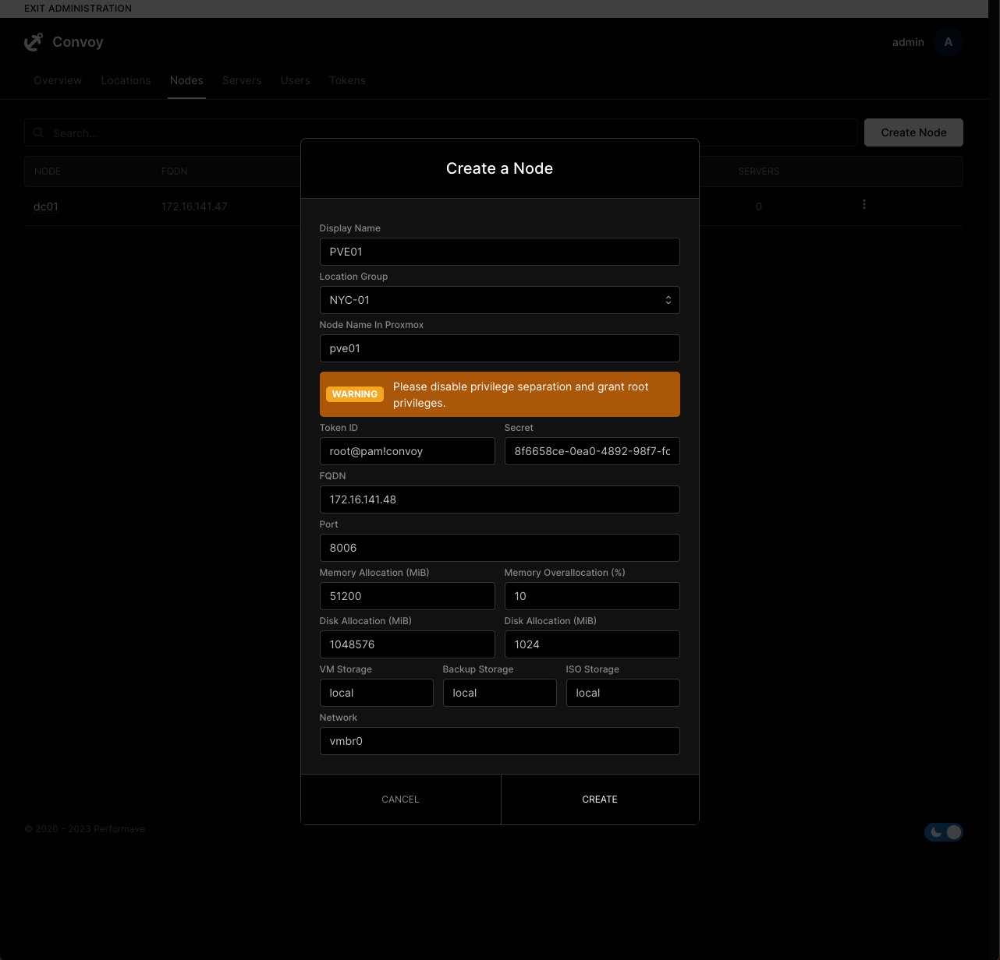

# Convoy documentation

Plain Markdown, rendered at [convoypanel.com/docs](https://convoypanel.com/docs). The ConvoyPanel
console pulls this repository every ten minutes and renders the pages itself, so there is no build
step and nothing to install here.

## Layout

| Path               | Holds                                                                                        |
|--------------------|----------------------------------------------------------------------------------------------|
| `docs/`            | The pages. `docs/panel/v4/getting-started.md` is served at `/docs/panel/v4/getting-started`. |
| `documentation.md` | The sidebar, as a nested Markdown list.                                                      |
| `assets/images/`   | Images, referenced from pages as `/assets/images/<file>`.                                    |

## Adding a page

1. Create the file under `docs/`. Its first line is a level-one heading; that heading is the page
   title, and the `##` and `###` headings below it make up the table of contents.
2. Add a line for it to `documentation.md`.

## Sidebar

`documentation.md` is a nested list indented with four spaces. An item without a link is a group; a
link is a page. Links are paths relative to `docs/` without the `.md` extension, or full URLs for
external sites. A `+` bullet starts a group collapsed.

```markdown
- Panel
    - v4
        - [Getting Started](panel/v4/getting-started)
        + Application API
            - [Getting Started](panel/v4/api/getting-started)
    + v3 (EOL)
        - [Getting Started](panel/v3/getting-started)
- Miscellaneous
    - [Resources](https://github.com/ConvoyPanel/panel/discussions/categories/resources)
```

## Alerts

Alerts use the GitHub syntax: a blockquote whose first line names the kind, with an optional title
after it. The kinds are `NOTE`, `TIP`, `IMPORTANT`, `WARNING` and `CAUTION`.

```markdown
> [!WARNING]
> The panel cannot be installed in a container due to limitations with Docker.

> [!TIP] Pro-tip
> Convoy comes with auto-TLS.
```

## API pages

A section (`##`) whose first line is an endpoint becomes an API reference: the text and fields on the
left, and request and response examples on the right. Write the method in bold and the path in code,
with no spaces in the path, so `<user_id>` and not `<user id>`; a path with a space is left as plain
text. Describe a request's fields in a table:

````markdown
## Adding an Address

**POST** `/api/application/address-pools/<pool_id>/addresses`

Adds one address to a pool.

Body parameters

| Field       | Type            | Required | Description                                |
|-------------|-----------------|----------|--------------------------------------------|
| `type`      | string          | Yes      | `ipv4` or `ipv6`.                          |
| `server_id` | integer or null | No       | Server to give the address to.             |

Payload

```json
{ "type": "ipv4", "server_id": null }
```

Returns

```json
{ "data": { "id": 14 } }
```
````

- The first column is headed `Field` (or `Parameter` for a `GET`'s query). `Type`, `Required` and
  `Description` are optional columns; a table with any other column stays a table.
- `Type` is free text. `Required` is `Yes` or `No`; a condition, such as "Required when
  `should_create_server` is `true`", goes in the description. Nested keys use dots (`limits.cpu`).
- The line above the table, `Body parameters` or `Query parameters`, is its title. Without one, a
  `GET` says "Query parameters" and the other methods "Body parameters".
- `Payload` is the request body, and the cURL, PHP, and JavaScript examples are built from it.
  `Returns` or `Response` is the response. A section has one payload; give each request shape its
  own section, even when they share a path.
- Without a table, the payload's keys and types are listed as the body parameters.

## Images and links

Put images in `assets/images/` and reference them by absolute path:

```markdown

```

Link to other pages by their URL path:

```markdown
[Coterm](/docs/misc/coterm)
```

## Contributing

Every rendered page links to its source file on GitHub, so small fixes can be made there directly.
For anything larger, read the [writing guide](.github/contributing/guidelines.md) first.
