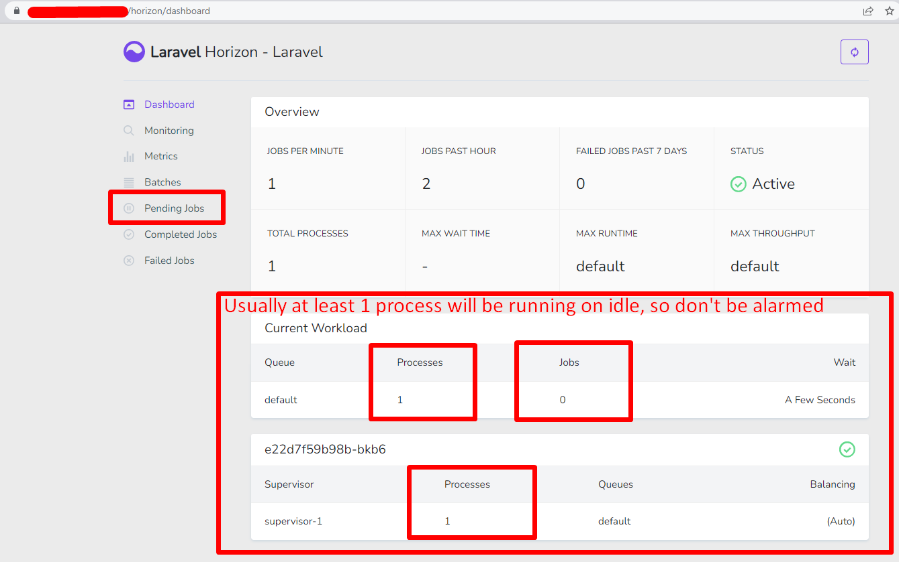

# Updating the Panel

This page covers updates within Convoy 5, for example from `5.0.0-alpha.1` to a newer 5.x release. To move a v4 panel
onto Convoy 5, follow [Upgrading from v4](/docs/panel/v5/upgrading-from-v4) instead.

## Finding Out About Updates

Security notices and news from the Convoy team that apply to your version appear on the admin overview. Critical ones
also appear as a banner on every page an administrator opens, until you update. **Admin → Settings → Updates** lists them all, along with the newest release on
GitHub, checked once an hour. That check only sees full releases, so during the alpha, new alphas appear on the
[releases page](https://github.com/ConvoyPanel/panel/releases) instead.

## Before You Begin

Make sure no jobs are running, such as a backup, a server installation, or a restore. Sign in as an administrator, open
`/horizon`, and wait until nothing is pending or processing. An update restarts the queue worker, which gives a running
job one minute to finish before stopping it, and a job stopped halfway can leave a server in an unknown state.



## Updating

```bash
convoy upgrade
```

It saves a copy of the database to `/opt/convoy/backups`, downloads the new release, restarts the panel, and waits for
it to report healthy. Database changes are applied on their own when the panel starts. If the panel isn't healthy
within five minutes, it says so and points you at `convoy logs web`.

## Choosing What You Update To

`convoy upgrade` updates to whatever `CONVOY_VERSION` in `/opt/convoy/.env` names:

| `CONVOY_VERSION` | Updates to                                               |
|------------------|----------------------------------------------------------|
| `5.0.0-alpha.1`  | Exactly that release, so `convoy upgrade` changes nothing. |
| `5.1`            | The newest 5.1.x release, once 5.1 is out.               |
| `5`              | The newest 5.x release, once 5.0 is out.                 |

None of them move a panel to Convoy 6 on its own.

During the alpha, every install names an exact release. To move to a newer alpha, edit `CONVOY_VERSION`, for example
to `5.0.0-alpha.2`, then run `convoy upgrade`.

## Getting Ready for Convoy 6

Convoy 6 will upgrade from Convoy 5, but it doesn't keep everything. **Admin → Settings → Upgrade** lists what it will
do with this panel's data, such as templates and ISOs it drops, nodes that need a new terminal setup, and backups it
deletes. It only reads, so it's safe to open at any time. The same list is available from the command line:

```bash
convoy artisan convoy:upgrade-check
```

Convoy 6 doesn't keep the activity log. To keep a copy, export it before you upgrade:

```bash
convoy export-activity > activity.csv
```
